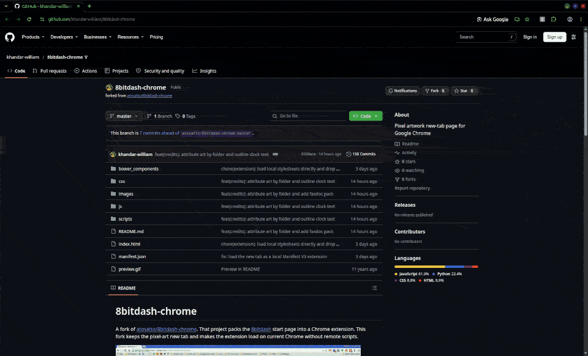

# 8bitdash-chrome

A fork of [atosatto/8bitdash-chrome](https://github.com/atosatto/8bitdash-chrome). That project packs the [8bitdash](https://github.com/8bitdash/8bitdash.github.io) start page into a Chrome extension. This fork keeps the pixel-art new tab and makes the extension load on current Chrome without remote scripts.



## Install in Chrome

Nothing needs compiling. The page Chrome opens is already in this folder.

1. Clone this repository, or download it and unzip it.
2. Open `chrome://extensions`.
3. Turn on **Developer mode**.
4. Click **Load unpacked** and choose the folder that contains `manifest.json`.
5. Open a new tab. The pixel-art page replaces Chrome's new tab.

Reload the extension from `chrome://extensions` after you change files.

Before loading, you can check that Chrome will accept the folder:

```bash
python3 scripts/check_mv3.py
```

It prints `ok` when the manifest is Manifest V3, the new-tab page loads only local scripts and stylesheets with no inline scripts or event handlers, no packaged name starts with `_`, and every image folder is listed as an art pack. Chrome refuses the names and remote loads it checks for.

To test the picture-stepping logic:

```bash
node scripts/check_step.js
```

It prints `ok` when stepping wraps correctly in both directions across art packs.

## Compared with upstream

[atosatto/8bitdash-chrome](https://github.com/atosatto/8bitdash-chrome) is Manifest V2, loads a script from `apps.madewithtea.com`, and runs Mixpanel from the new-tab page. Current Chrome will not load that package. This fork changes three things:

- **Manifest V3, and a folder Chrome can load.** Two library files whose names started with `_` were renamed. Chrome rejects an unpacked extension that contains those names.
- **The new tab stays on this machine.** Scripts, images, fonts, and connections are limited to files in the extension. There is no analytics call.
- **The start page is only the dashboard.** It still shows the clock, a greeting in the saved language, the artist credit, and a pixel-art background. Left and right step through the pictures in every art pack, wrapping from the last picture of one pack into the next. **H** opens settings for language and art pack. The language is remembered. Each new tab shows a picture picked at random from all the art packs together. Choosing a pack in settings starts at its first picture. The bookmark map and the single-key shortcuts to other sites are gone.

## Credits

Andrea Tosatto wrote the upstream extension: [github.com/atosatto](https://github.com/atosatto).

All pictures were copied from [atosatto/8bitdash-chrome](https://github.com/atosatto/8bitdash-chrome) and [hlindhe/8bitdash.github.io](https://github.com/hlindhe/8bitdash.github.io).

This extension bundled the following third-party code:

- [dat.GUI](https://github.com/dataarts/dat.gui) 0.5.0 (`bower_components/dat-gui/build/dat.gui.min.js`). Copyright 2011 Data Arts Team, Google Creative Lab. [Apache License 2.0](https://www.apache.org/licenses/LICENSE-2.0).
- [alertify.js](https://github.com/alertifyjs/alertify.js) 0.3.12 (`bower_components/alertifyjs/dist/js/alertify.js` and `bower_components/alertifyjs/dist/css/alertify.css`). Copyright Fabien Doiron. [MIT License](https://opensource.org/licenses/MIT).
- [basil.js](https://github.com/Wisembly/basil.js) 0.4.0 (`bower_components/basil.js/build/basil.min.js`). Copyright 2014 Wisembly and contributors. [MIT License](https://opensource.org/licenses/MIT).
- [Skeleton](https://github.com/dhg/Skeleton) 2.0.4 (`bower_components/skeleton/skeleton.css`). Copyright 2014 Dave Gamache. [MIT License](https://opensource.org/licenses/MIT).
- [fullPage.js](https://github.com/alvarotrigo/fullPage.js) 2.5.6 stylesheet (`bower_components/fullpage.js/jquery.fullPage.css`). The file header still says fullPage 2.4.6. Copyright 2013 Alvaro Trigo. [MIT License](https://opensource.org/licenses/MIT).
- [Minecraft](https://fontstruct.com/fontstructions/show/432966) by Pwnage_Block, built with FontStruct in 2011 (`css/font.css` and the `minecraftfont` files). [Creative Commons Attribution-ShareAlike 3.0](https://creativecommons.org/licenses/by-sa/3.0/).
